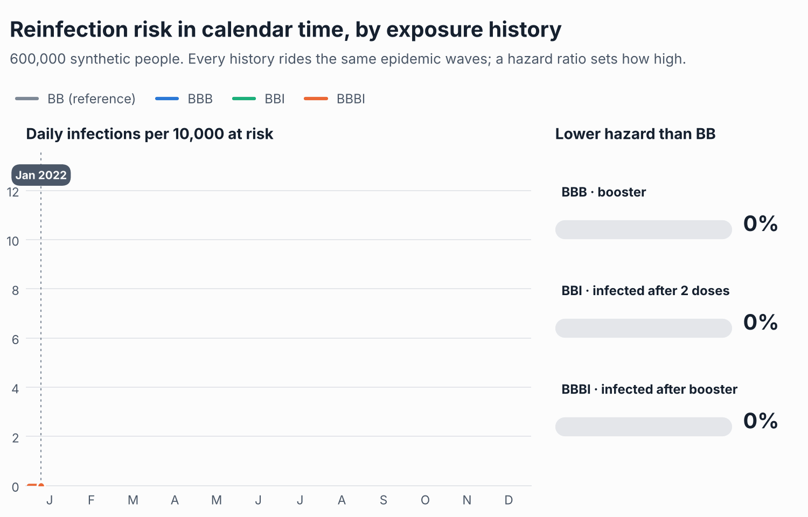
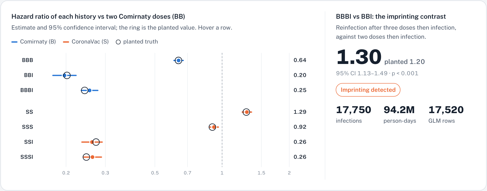
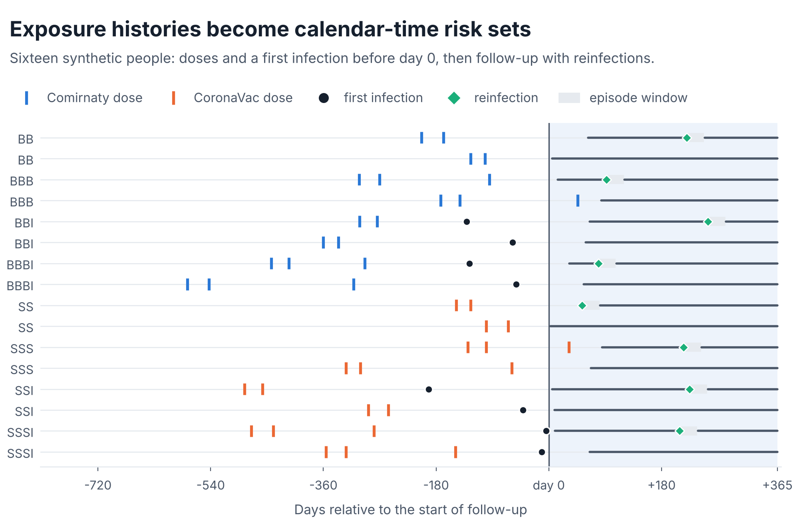
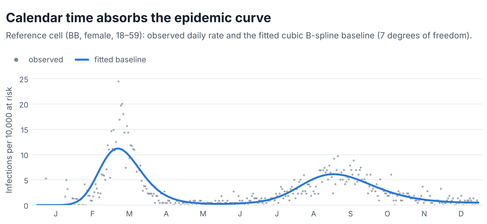
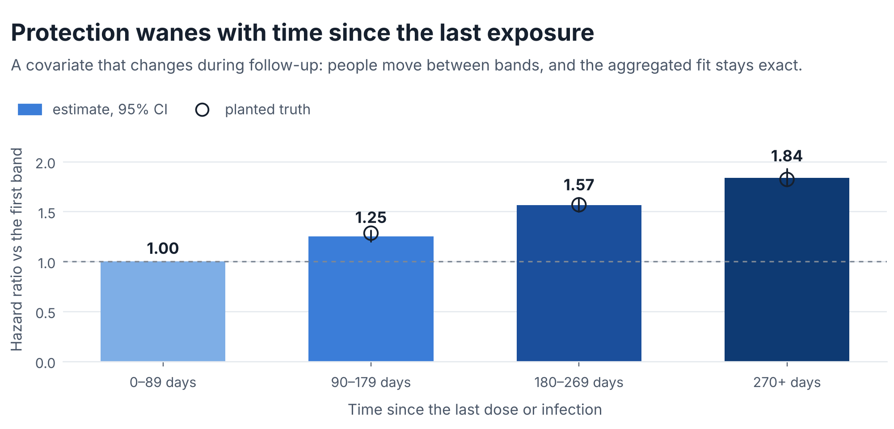
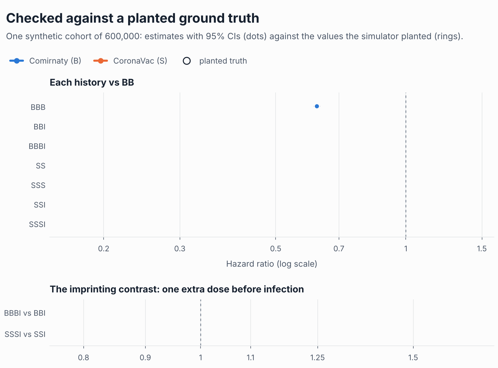
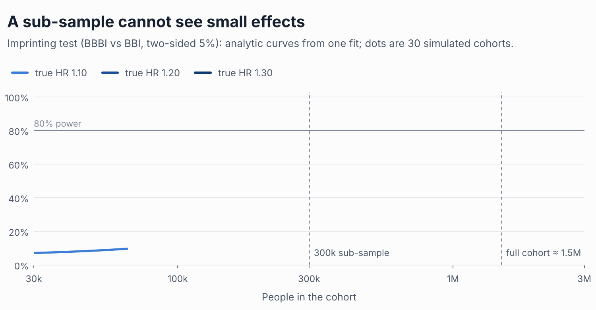
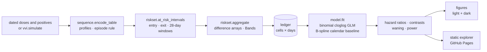
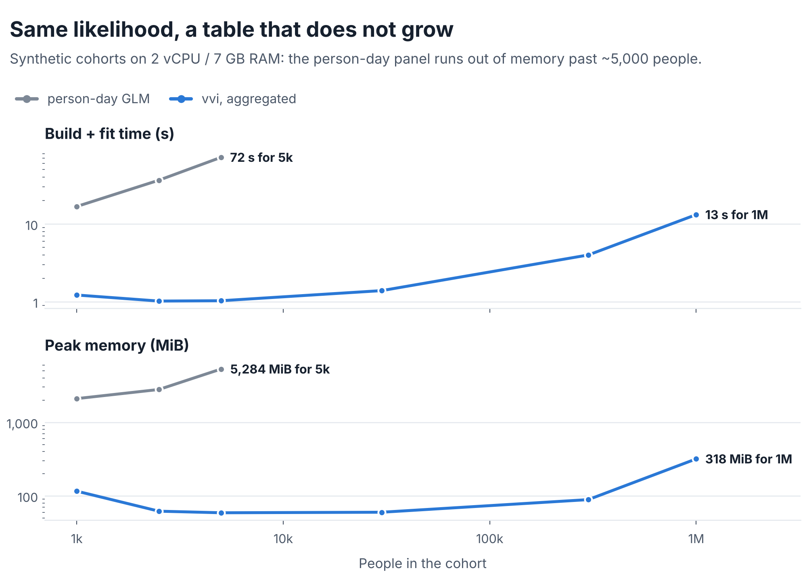

<div align="center">

# VVI: Hybrid Immunity in Calendar Time

**Does a booster before your first Omicron infection protect you, or imprint you?**

A Python toolkit that fits exact, sampling-free discrete-time hazard models to
vaccination–infection histories, and estimates hybrid immunity, immune imprinting,
waning and the cohort size each question needs.

[](https://github.com/EllenSyuu/VVI/actions/workflows/ci.yml)


[](LICENSE)

**[Live explorer](https://ellensyuu.github.io/VVI/)** · [Why](#why) · [Quick start](#quick-start) · [What it estimates](#what-it-estimates) · [Validation](#validated-against-a-planted-ground-truth) · [Engineering](#engineering) · [Docs](docs/)

</div>

<picture>
  <source media="(prefers-color-scheme: dark)" srcset="docs/img/hero-dark.gif">
  
</picture>

<sub>All figures and animations in this repository are generated from **synthetic data** by `scripts/render_assets.py`. The repository contains no real data.</sub>

## Why

Hong Kong's 2022 Omicron waves reached a population vaccinated with two very different
platforms, Comirnaty (mRNA, **B**) and CoronaVac (inactivated, **S**), often with two,
three or four doses before a first infection (**I**). Two questions follow: how much
protection against reinfection does each history carry, and does an extra
pre-infection dose *raise* reinfection risk, the pattern reported as **immune imprinting**?

The natural model is a discrete-time hazard on calendar days, so every history is compared
under the same force of infection. Fitted naively it needs one row per person per day,
about 5 × 10⁸ rows for a territory-wide cohort, which forces analysts to sub-sample. VVI
fits the **same likelihood exactly** from people-at-risk and event counts per covariate
cell and day: at most cells × days rows, whatever the cohort size. No sub-sampling, and
therefore the power to see small effects.

The package is a clean-room re-implementation of the method from my HKU final-year
project (STAT4799, 2023–24, supervised by Dr Eddy K. F. Lam), rebuilt as a typed,
tested library with a CLI, a simulator that serves as ground truth, publication-ready
figures and a static interactive explorer.

## Interactive explorer

A static, dependency-free page: choose a true imprinting effect and a cohort size and see
the estimates land on the planted values; drag the effect size to see the power of the test
at a 300k sub-sample and at the full cohort; compare the cost of the person-day and
aggregated fits. It is built from synthetic data by `scripts/build_site.py` and deployed
with GitHub Pages.

<a href="https://ellensyuu.github.io/VVI/">
<picture>
  <source media="(prefers-color-scheme: dark)" srcset="docs/img/explorer-dark.png">
  
</picture>
</a>

## Quick start

```bash
git clone https://github.com/EllenSyuu/VVI && cd VVI
python -m pip install -e ".[dev]"

vvi demo          # simulate 300k people → aggregate → fit, with the planted truth alongside
make check        # ruff · mypy · pytest (38 tests)
make explorer     # build the explorer from synthetic data and serve it at localhost:8000
```

```python
import vvi

cohort = vvi.simulate(300_000, seed=1)                       # or your own people / events tables
ledger = vvi.aggregate(cohort.people, cohort.events, horizon=365, blank_days=28)
fit = vvi.fit(ledger, reference="BB")

fit.table()                       # hazard ratios, 95% CIs, protection effectiveness, p-values
fit.contrast("BBBI", "BBI")       # the imprinting test
vvi.required_size(fit.contrast("BBBI", "BBI"), n_fit=300_000, log_hr=0.1)
```

To analyse your own cohort, provide a `people` table (`id, entry, exit` and the cell
columns `profile, sex, age_band`; `anchor` for waning) and an `events` table (`id, day`).
`vvi.encode_table` turns dated doses and positives into profile strings. The
[tutorial notebook](examples/quickstart.ipynb) walks through every step.

## What it estimates

| Quantity | Question it answers |
|---|---|
| **Hazard ratio by history** | How much lower is the reinfection hazard of `BBI`, `BBBI`, `SSSI`, … than of a reference history? |
| **Imprinting contrast** | Among people infected after vaccination, does one extra pre-infection dose raise the hazard (`BBBI` vs `BBI`)? |
| **Calendar baseline** | What did the epidemic curve look like? A cubic B-spline in calendar time absorbs the waves. |
| **Waning** | How does protection fade with time since the last dose or infection? (a covariate that changes during follow-up) |
| **Power and required size** | How many people does a contrast need to be detected, and what does sub-sampling cost? |

<picture>
  <source media="(prefers-color-scheme: dark)" srcset="docs/img/histories-dark.png">
  
</picture>

<picture>
  <source media="(prefers-color-scheme: dark)" srcset="docs/img/calendar-dark.png">
  
</picture>

<picture>
  <source media="(prefers-color-scheme: dark)" srcset="docs/img/waning-dark.png">
  
</picture>

Model, risk-set rules, derivations and limitations: [docs/method.md](docs/method.md).

## Validated against a planted ground truth

The simulator plants every effect the model estimates (hazard ratios by history, an
imprinting-like contrast for one platform, sex and age effects, waning, two epidemic waves,
staggered entry, censoring and recurrent infections with a 28-day episode window) and
keeps the true values. The test suite checks that the aggregated fit equals the
person-day fit to 10⁻⁷, that event and at-risk counts match cell by cell, and that every
planted effect is recovered.

| Hazard ratio | Planted | Estimated | 95% CI | Truth in CI |
|---|---:|---:|---:|:---:|
| BBB vs BB | 0.638 | 0.622 | 0.602–0.644 | ✓ |
| BBI vs BB | 0.202 | 0.192 | 0.177–0.209 | ✓ |
| BBBI vs BB | 0.259 | 0.252 | 0.237–0.268 | ✓ |
| SS vs BB | 1.284 | 1.260 | 1.219–1.303 | ✓ |
| SSS vs BB | 0.905 | 0.894 | 0.866–0.923 | ✓ |
| SSI vs BB | 0.273 | 0.267 | 0.248–0.287 | ✓ |
| SSSI vs BB | 0.247 | 0.257 | 0.240–0.274 | ✓ |
| **BBBI vs BBI** | **1.284** | **1.310** | **1.189–1.443** | ✓ |
| SSSI vs SSI | 0.905 | 0.960 | 0.877–1.052 | ✓ |

<sub>One synthetic cohort, seed 2024: 600,000 people, 35,305 infections, 188 million person-days fitted from 17,520 rows.</sub>

<picture>
  <source media="(prefers-color-scheme: dark)" srcset="docs/img/recovery-dark.gif">
  
</picture>

Power is checked the same way: analytic curves from one fit agree with the share of 30
simulated cohorts that detect the effect, and the test holds its size under the null
([docs/power.md](docs/power.md)). A true imprinting HR of 1.10 has **27%** power in a 300k
sub-sample and **85%** in a cohort of 1.5 million.

<picture>
  <source media="(prefers-color-scheme: dark)" srcset="docs/img/power-dark.gif">
  
</picture>

## Engineering



| Principle | How it shows up |
|---|---|
| **Sufficient statistics, not samples** | `aggregate` scatters ±1 at interval ends into a cells × days difference array, `O(people + events)`, and never builds a person-day row. |
| **Exactness as a contract** | Tests require the aggregated and person-day fits to agree to 10⁻⁷ and their counts to match cell by cell, with and without time-varying bands. |
| **Time-varying covariates stay exact** | `Bands` cuts at-risk intervals where a person crosses a band edge, so people move between cells and the identity still holds. |
| **Calendar time as the time scale** | Every history is compared on the same days under the same force of infection; no immortal time. |
| **A simulator as ground truth** | Deterministic generator with known parameters; recovery, power and test size are checked against it. |
| **Data never enter the repository** | Clean-room code; `.gitignore` and a CI data guard reject data files and restricted field names. See [docs/data-governance.md](docs/data-governance.md). |
| **Reproducible outputs** | Every README image (PNG and animated GIF, light and dark) is re-rendered by `scripts/render_assets.py`; results in `docs/results` by `scripts/benchmark.py` and `scripts/power_study.py`. |
| **Automation** | CI on Python 3.10–3.13 (data guard, Ruff, mypy, 38 tests including figure smoke tests, CLI demo); on-demand Pages deployment of the explorer. |

<picture>
  <source media="(prefers-color-scheme: dark)" srcset="docs/img/benchmark-dark.png">
  
</picture>

## Repository layout

```
src/vvi/        sequence · riskset · model · power · simulate · plots · cli
scripts/        render_assets · build_site · benchmark · power_study · make_notebook · check_no_data
tests/          encoding, count identities, exact equivalence, recovery, waning, power, figures
examples/       quickstart notebook (executed, synthetic)
docs/           method, benchmark, power, data governance, explorer page, results, images
```

## Citation and licence

If you use this software, please cite it via [`CITATION.cff`](CITATION.cff) (GitHub's
"Cite this repository" button). Released under the [Apache License 2.0](LICENSE);
see [`NOTICE`](NOTICE).
