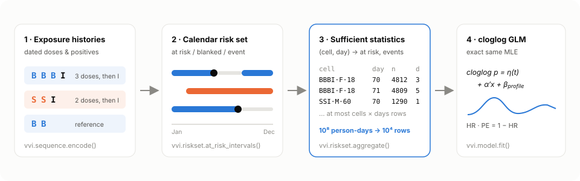
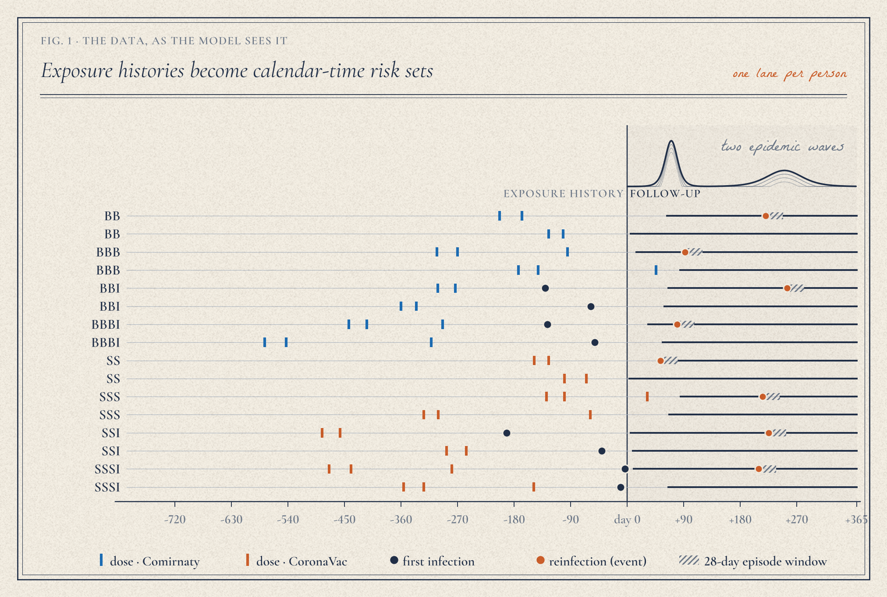
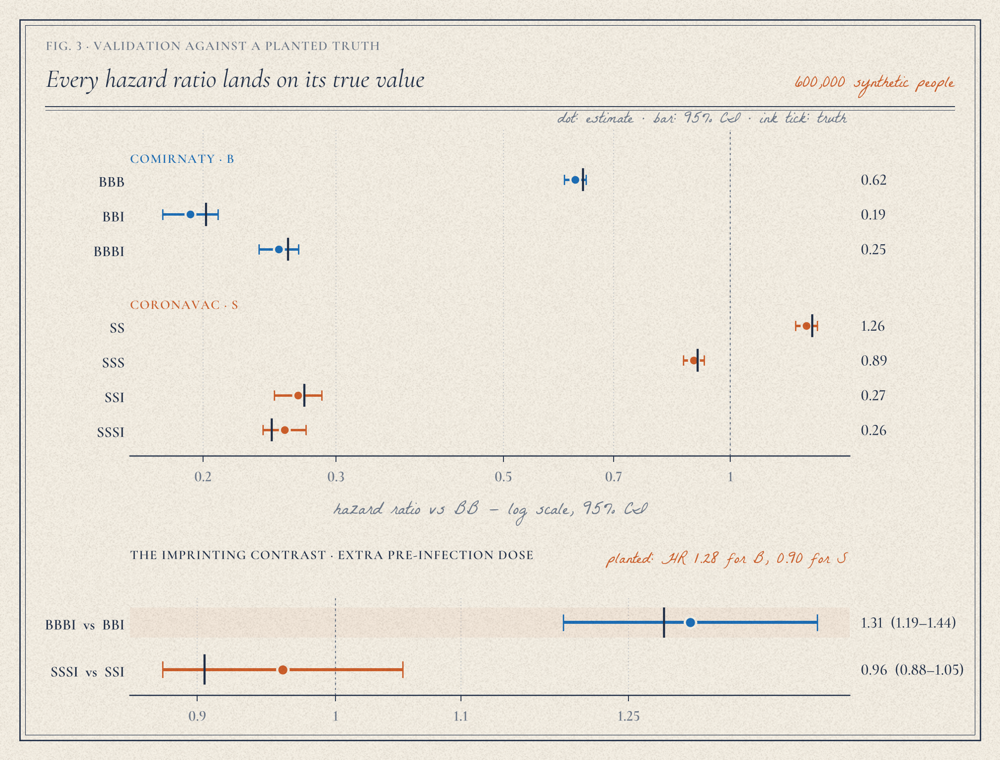
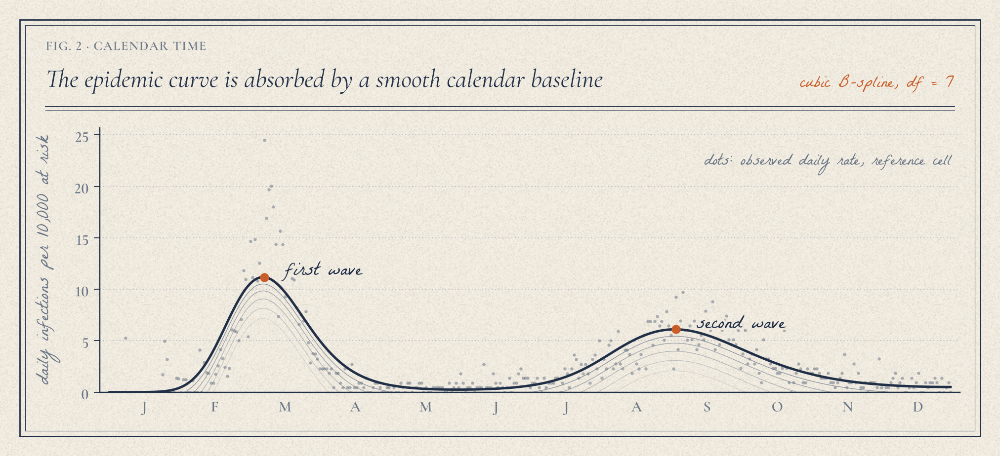
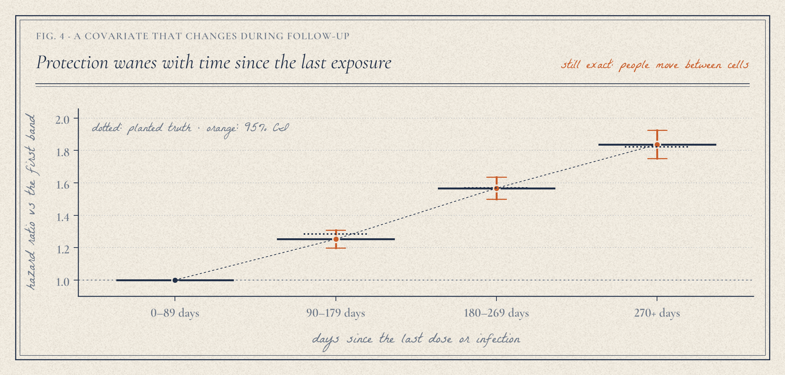
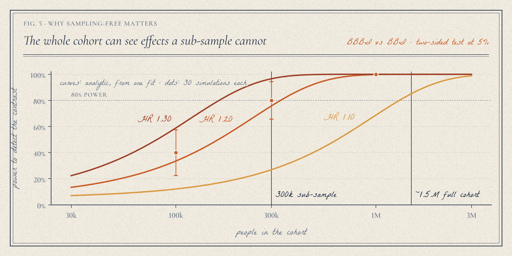
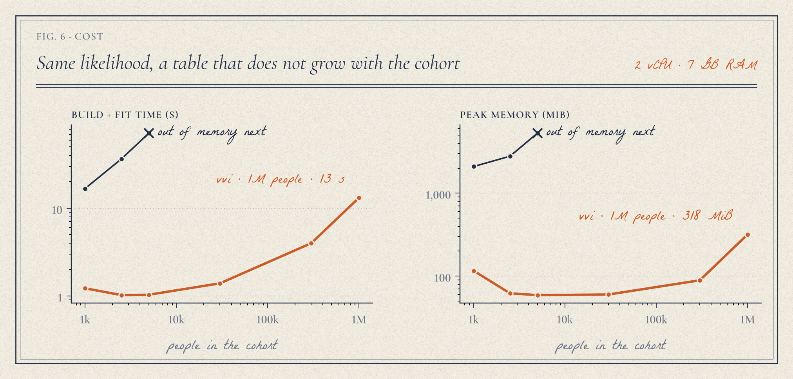

<div align="center">

<a href="https://ellensyuu.github.io/VVI/"></a>

# VVI · Hybrid Immunity in Calendar Time

**Does a booster before your first Omicron infection protect you — or *imprint* you?**<br>
An exact, sampling-free hazard model for vaccination–infection histories, as a tested Python package.

[](https://github.com/EllenSyuu/VVI/actions/workflows/ci.yml)


[**Interactive explorer**](https://ellensyuu.github.io/VVI/) ·
[Method](docs/method.md) ·
[Benchmark](docs/benchmark.md) ·
[Power study](docs/power.md) ·
[Tutorial notebook](examples/quickstart.ipynb)

</div>

---

## At a glance

| | |
|---|---|
| **Question** | How protective is each vaccination–infection history (`BBI`, `BBBI`, `SSSI`, …) against reinfection — and does an extra pre-infection dose *raise* reinfection risk (immune imprinting)? |
| **Model** | Discrete-time cloglog hazard in **calendar time** — the grouped-time form of an Andersen–Gill model — with a B-spline epidemic baseline. `exp(β)` is a hazard ratio. |
| **Key idea** | The likelihood depends on the data only through *people at risk* and *events* per covariate cell and day. Fitting those counts gives the **same estimates and standard errors** as the person-day model, on a table that does not grow with the cohort. |
| **Result** | 1,000,000 people (314 M person-days) fit in **13 s and 0.3 GB**; the naive person-day fit needs 72 s and 5.3 GB for **5,000** people. Aggregated and person-day estimates agree to 10⁻⁷. |
| **Why it matters** | No sub-sampling: a 300k sub-sample has **27%** power to detect an imprinting HR of 1.10; the full ~1.5M cohort has **85%**. |
| **Extensions** | Waning by time since last exposure (a covariate that changes during follow-up) — still exact. Wald power and required cohort size from a single fit. |
| **Validation** | 35 tests, 97% coverage: encoding rules, count identities, exact equivalence, recovery of planted effects, Monte-Carlo checks of power and test size. |

## Why this exists

Hong Kong's 2022 Omicron waves landed on a population vaccinated with two very different
platforms — Comirnaty (mRNA, **B**) and CoronaVac (inactivated, **S**) — often with two,
three or four doses before a first infection (**I**). My HKU final-year project
(STAT4799, 2023–24, supervised by Dr Eddy K. F. Lam) analysed territory-wide linked
records with a calendar-day cloglog model. Those records are licensed and stay in their
environment; this repository is a **clean-room re-implementation** of the method, rebuilt
as a reusable, tested package — with one engineering change that removes the original
bottleneck: the person-day panel had to be **sub-sampled** to fit at all. Here it never
has to be built.

## How it works



1. **Histories → profiles.** `encode_table` turns dated doses and positives into profile
   strings (`BBBI` = three Comirnaty doses, then infection), merging positives within 28 days
   into one episode and treating later infections as outcomes, not exposures.
2. **Calendar follow-up.** Each person is at risk from entry to exit, except for the 28 days
   after each infection; reinfections recur (Andersen–Gill).
3. **A ledger, not a panel.** `aggregate` scatters ±1 at interval ends into a
   *cells × days* difference array and takes a cumulative sum — `O(people + events)`, with no
   person-day row ever materialised.
4. **Exact GLM.** `fit` runs a binomial cloglog GLM on the ledger: hazard ratios, protection
   effectiveness `PE = 1 − HR`, and any profile contrast with a Wald CI.



## Results on synthetic cohorts

Every cohort below is simulated from the model with known parameters — two epidemic waves,
staggered entry, censoring, recurrent infections — and an imprinting-like effect planted for
one platform. Nothing here is real data.



<table><tr>
<td width="50%"></td>
<td width="50%"></td>
</tr><tr>
<td><b>Calendar time</b> absorbs the epidemic waves, so every profile is compared under the same force of infection.</td>
<td><b>Waning</b> enters as time-since-exposure bands; people move between cells during follow-up and the fit stays exact.</td>
</tr></table>





The [**interactive explorer**](https://ellensyuu.github.io/VVI/) lets you plant an
imprinting effect of your choice, change the cohort size and watch the fit recover it —
21 scenarios, each simulated and fitted by the package.

## Quickstart

```bash
pip install "vvi[plot] @ git+https://github.com/EllenSyuu/VVI"
vvi demo --n 300000
```

```text
synthetic cohort : 300,000 people, 17,757 infections
risk set         : 94,222,268 person-days -> 17,520 rows (5,378x smaller)
timings          : simulate 2.3s | aggregate 0.52s | fit 0.41s

           term  log_hr    se    hr  ci_low  ci_high     pe      p true_hr
            BBB  -0.465 0.024 0.628   0.599    0.659  0.372 <0.001   0.638
           BBBI  -1.316 0.042 0.268   0.247    0.291  0.732 <0.001   0.259
            BBI  -1.679 0.061 0.187   0.165    0.210  0.813 <0.001   0.202
            ...
imprinting contrast BBBI vs BBI: HR 1.44 (95% CI 1.25-1.65), p=2.2e-07
```

### Python API

```python
import vvi

# a synthetic cohort and its dated exposure histories
cohort = vvi.simulate(300_000, seed=1)                 # people (+ anchor, entry, exit), events
history = vvi.histories(cohort)                        # id, day, kind ("Comirnaty", "infection", …)
assert (vvi.encode_table(history) == cohort.people.set_index("id").profile).all()

# sufficient statistics -> exact fit
ledger = vvi.aggregate(cohort.people, cohort.events, horizon=365, blank_days=28)
fit = vvi.fit(ledger, reference="BB", df=7)
fit.table()                                            # HR, 95% CI, PE = 1 − HR, p
fit.contrast("BBBI", "BBI")                            # the imprinting test
fit.baseline_hazard(range(365))                        # fitted epidemic curve

# waning: a covariate that changes during follow-up, still exact
bands = vvi.Bands(edges=(0, 90, 180, 270))
ledger = vvi.aggregate(cohort.people, cohort.events, horizon=365, bands=bands)
fit = vvi.fit(ledger, reference="BB", covariates=("sex", "age_band", "since"))
fit.covariate_effects("since")                         # HR by days since last exposure

# how many people does a contrast need?
effect = fit.contrast("BBBI", "BBI")
vvi.power(effect, n_fit=300_000, sizes=[1e5, 3e5, 1e6], log_hr=0.1)
vvi.required_size(effect, n_fit=300_000, target=0.8, log_hr=0.1)
```

Your own data needs a `people` table (`id, entry, exit`, the cell columns — `profile, sex,
age_band` by default — and `anchor` for waning bands) and an `events` table (`id, day`).
Analysis windows such as a variant era are one argument: `aggregate(..., window=(180, 365))`.
`vvi.plots` draws every figure above in the same style (fonts are bundled).

## Repository layout

```
src/vvi/
  sequence.py   histories → profile strings (BBBI, SSA, …), study filters, encode_table
  riskset.py    at-risk intervals, Bands, sufficient-statistic aggregation, person-day expansion
  model.py      cloglog GLM, hazard ratios, contrasts, covariate effects, fitted calendar curve
  power.py      Wald power and required cohort size from one fit
  simulate.py   synthetic cohort with known truth, waning, dated exposure histories
  plots.py      the Atelier figure style (fonts: Cormorant Garamond, La Belle Aurore, SIL OFL)
  cli.py        `vvi demo`
tests/          35 tests · encoding, count identities, exact equivalence, recovery, power
examples/       quickstart notebook (executed, synthetic)
scripts/        figures, pipeline diagram, benchmark, power study, explorer data, data guard
docs/           method, benchmark, power, data governance, figures, results (JSON)
site/           the interactive explorer (GitHub Pages)
```

Reproduce everything: `python scripts/benchmark.py && python scripts/power_study.py &&
python scripts/make_figures.py && python scripts/draw_pipeline.py && python scripts/build_site.py`.

## Data governance

No record, extract, schema or result from the licensed study is in this repository —
only code, a simulator with invented parameters, and synthetic outputs. `.gitignore` blocks
data formats, and a CI job (`scripts/check_no_data.py`) fails on data-like files or restricted
field names. See [`docs/data-governance.md`](docs/data-governance.md).

## Citation

```bibtex
@software{zhou_vvi_2026,
  author  = {Zhou, Ziyi},
  title   = {VVI: hybrid immunity and immune imprinting in calendar time},
  year    = {2026},
  version = {0.2.0},
  url     = {https://github.com/EllenSyuu/VVI}
}
```

## License

Code: [Apache-2.0](LICENSE) © Ziyi Zhou. Bundled fonts: SIL Open Font License
([`src/vvi/fonts/licenses`](src/vvi/fonts/licenses)). The hero plate is drawn for
[ellensyuu.github.io](https://ellensyuu.github.io).
