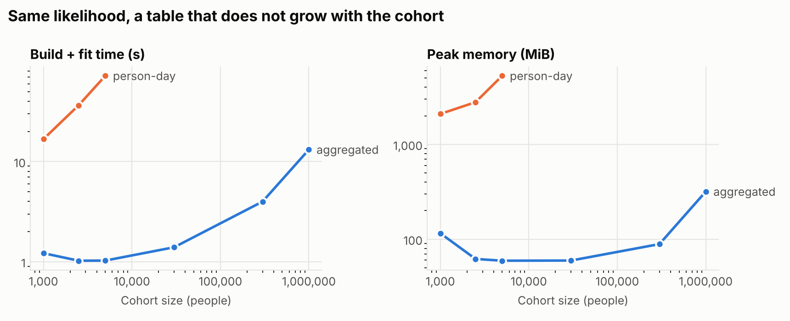
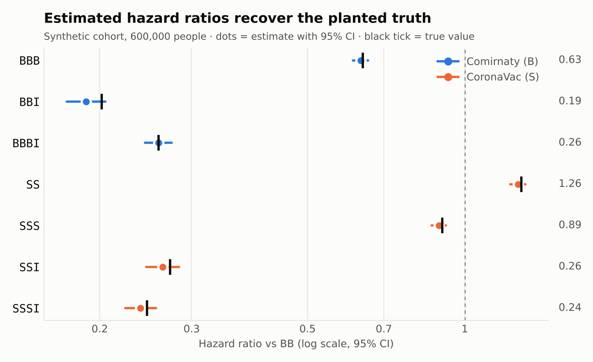
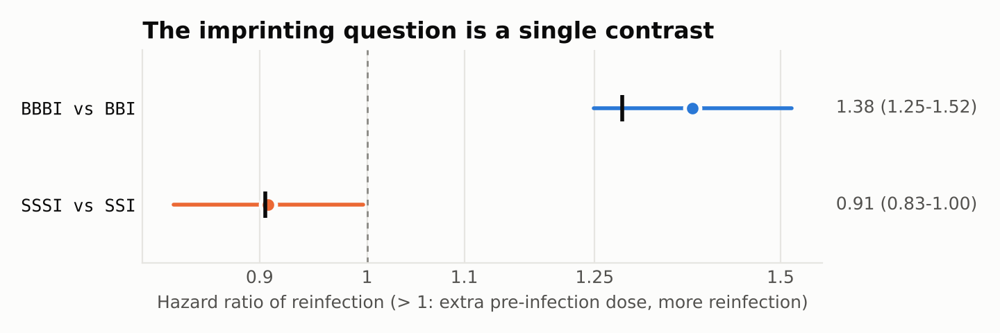
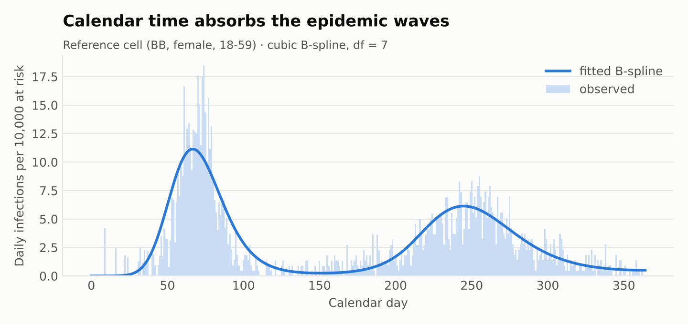

<div align="center">

# VVI · Hybrid Immunity in Calendar Time

**Does a booster before your first Omicron infection protect you — or imprint you?**
<br>Exact, sampling-free discrete-time hazard models for comparing vaccination–infection histories.

[](https://github.com/EllenSyuu/VVI/actions/workflows/ci.yml)


</div>

---

## Why this exists

Hong Kong's 2022 Omicron waves landed on a population vaccinated with two very
different platforms — Comirnaty (mRNA, **B**) and CoronaVac (inactivated, **S**) —
often with two, three or four doses before a first infection (**I**). My HKU final-year
project (STAT4799, 2023–24, supervised by Dr. Eddy K. F. Lam) asked two questions of
territory-wide linked records:

1. **Hybrid immunity** — how protective is each vaccination–infection profile
   (`BBI`, `BBBI`, `SSSI`, …) against reinfection?
2. **Immune imprinting** — among people who were infected, is an *extra
   pre-infection dose* associated with **more** reinfection (`VVVI` vs `VVI`), as
   reported for Qatar?

Those records are licensed and cannot leave their environment. This repository is a
**clean-room re-implementation** of the method as a tested, reusable package — with
one engineering change that removes the original bottleneck.

## The idea in one paragraph

The model is a Bernoulli GLM on **person-days**: ~1.5 million adults × 365 days ≈
5×10⁸ rows. The original pipeline had to sub-sample a few hundred thousand people and
write one file per calendar day just to fit it. But the likelihood depends on the data
only through *(people at risk, events)* per **covariate cell × calendar day**. A
binomial GLM on those counts has the **same MLE and the same standard errors** — and
at most `cells × days` rows (here 17,520), no matter how large the cohort. `vvi`
builds that table with difference arrays over at-risk intervals, never materialising
a person-day row.



| | people | person-days | GLM rows | build + fit | peak memory |
|---|---:|---:|---:|---:|---:|
| person-day GLM | 5,000 | 1.6 M | 1.6 M | 72 s | 5.3 GB |
| **`vvi` aggregated** | **1,000,000** | **314 M** | **17,520** | **13 s** | **0.3 GB** |

Full table: [`docs/benchmark.md`](docs/benchmark.md) · reproduce with `python scripts/benchmark.py`.
On a 7 GB machine the person-day route runs out of memory beyond ~5,000 people; the aggregated route fits 200× that cohort in a fifth of the time.

## Validated against a known truth

`vvi.simulate` generates a cohort from the model itself — two-wave epidemic, staggered
entry, censoring, recurrent infections with a 28-day episode window — and plants an
imprinting-like effect for one platform. The fit recovers it.



<table><tr>
<td width="50%"></td>
<td width="50%"></td>
</tr><tr>
<td>The imprinting question is one linear contrast with a Wald CI.</td>
<td>Calendar time absorbs the epidemic waves, so every profile is compared under the same force of infection.</td>
</tr></table>

All numbers and figures in this repository come from **synthetic data**.

## Quickstart

```bash
pip install "vvi[plot] @ git+https://github.com/EllenSyuu/VVI"
vvi demo --n 300000
```

```text
synthetic cohort : 300,000 people, 17,641 infections
risk set         : 94,225,640 person-days -> 17,520 rows (5,378x smaller)
timings          : simulate 1.3s | aggregate 0.36s | fit 0.24s

           term  log_hr    se    hr  ci_low  ci_high     pe  true_hr
            BBB  -0.468 0.024 0.626   0.597    0.657  0.374    0.638
           BBBI  -1.367 0.043 0.255   0.234    0.277  0.745    0.259
            BBI  -1.639 0.060 0.194   0.173    0.219  0.806    0.202
            ...
imprinting contrast BBBI vs BBI: HR 1.31 (95% CI 1.15-1.50), p=8.7e-05
```

### Python API

```python
from datetime import date
import vvi

# 1. encode an exposure history
vvi.encode([vvi.Event(date(2021, 3, 1), "Comirnaty"),
            vvi.Event(date(2021, 3, 22), "Comirnaty"),
            vvi.Event(date(2022, 3, 2), "infection"),
            vvi.Event(date(2022, 3, 10), "infection")])   # same episode → 'BBI'

# 2. calendar-time risk set → sufficient statistics
cohort = vvi.simulate(300_000, seed=1)                      # or your own people/events tables
table = vvi.aggregate(cohort.people, cohort.events, horizon=365, blank_days=28)

# 3. fit and read off hazard ratios
fit = vvi.fit(table, reference="BB", df=7)
fit.table()                                  # HR, 95% CI, PE = 1 - HR, p
fit.contrast("BBBI", "BBI")                  # imprinting test
fit.baseline_hazard(range(365))              # fitted epidemic curve
```

`people` needs `id, entry, exit` plus the cell columns (`profile, sex, age_band` by
default); `events` needs `id, day`. Analysis windows (e.g. a variant era) are one
argument: `aggregate(..., window=(180, 365))`.

## Model

For person *i* at risk on calendar day *t*:

$$\log\{-\log(1-p_{it})\} = \eta(t) + \alpha^\top x_i + \beta_{\text{profile}(i)}$$

* complementary log–log link → `exp(β)` is a **hazard ratio** (grouped-time
  proportional hazards, the discrete counterpart of an Andersen–Gill model);
* `η(t)` is a cubic B-spline with knots fixed in calendar time;
* **protection effectiveness** `PE = 1 − HR`; any two profiles compared by a contrast.

Derivations, risk-set rules and limitations (waning, selection into boosting and
testing): **[`docs/method.md`](docs/method.md)**.

## Repository layout

```
src/vvi/
  sequence.py    exposure histories → profile strings (BBBI, SSA, …), study filters
  riskset.py     at-risk intervals, sufficient-statistic aggregation, person-day expansion
  model.py       cloglog GLM, hazard ratios, contrasts, fitted calendar curve
  simulate.py    synthetic cohort with known ground truth
  plots.py       forest and trend plots
  cli.py         `vvi demo`
tests/           27 tests: encoding rules, count identities, exact equivalence, recovery
scripts/         figure generation, benchmark, CI data guard
docs/            method, benchmark, data governance, figures
```

## Data governance

No record, extract, schema or result from the licensed study is in this repository —
only code, a simulator with invented parameters, and synthetic outputs. `.gitignore`
blocks data formats and a CI job (`scripts/check_no_data.py`) fails on data-like files
or restricted field names. See [`docs/data-governance.md`](docs/data-governance.md).

## Citation

```bibtex
@software{zhou_vvi_2026,
  author  = {Zhou, Ziyi},
  title   = {VVI: hybrid immunity and immune imprinting on calendar-time risk sets},
  year    = {2026},
  version = {0.1.0},
  url     = {https://github.com/EllenSyuu/VVI}
}
```

## License

[Apache-2.0](LICENSE) © Ziyi Zhou
